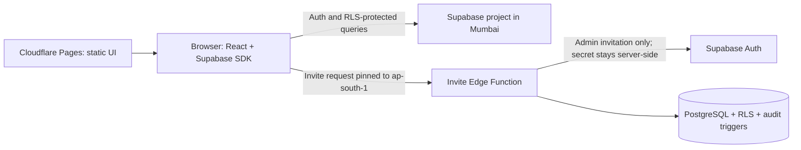

# TrustVendor AI — web launch project

The production-oriented application lives in `web/` and uses Supabase for authentication and the Mumbai PostgreSQL project, with a static Cloudflare Pages deployment for the user interface. The earlier `app.py` and `static/` app are a local demonstration only; do not use them for real supplier data.

## What is included

- Email/password sign-up, email confirmation, sign-in, password reset, and session refresh through Supabase Auth.
- Organization workspaces with Owner, Admin, Reviewer, and Viewer roles.
- Database row-level security on every application table. Supplier data is scoped in PostgreSQL to the signed-in user’s workspace.
- Supplier intake, five review checks, evidence-source and reviewer notes, explainable checklist exposure points, and an append-only activity log.
- Workspace invitations through a Supabase Edge Function. The function verifies the caller’s role, limits invites, and adds existing accounts only after email confirmation.
- Security response headers and a restrictive Content Security Policy for the Cloudflare Pages frontend.
- A versioned schema migration under `supabase/migrations/`.

There are no demo suppliers in this application. The score reflects checklist evidence entered by the team; it is not an independently calculated fraud probability or supplier certification. The app does not yet connect to official registries, banks, sanctions databases, or AI providers. It does not upload or store evidence documents; reviewers record source references and notes only.

## Architecture



The Supabase publishable key is expected in the browser; it is not an admin credential. Never expose a Supabase secret/service-role key in `web/`, a `VITE_` variable, Git, or the browser. The invitation Edge Function needs a secret key stored in Supabase Function Secrets.

## Run the web app locally

Install Node.js 24 or newer with npm. Then in PowerShell:

```powershell
cd "C:\Users\Admin\OneDrive\Documents\ChatGPT\Final Year\web"
Copy-Item .env.example .env.local
```

Edit `web/.env.local` and enter the Supabase Project URL and **publishable key**. These are public client settings; never enter the secret key here. Then run:

```powershell
npm install
npm run dev
```

Open the local URL printed by Vite (normally `http://127.0.0.1:5173`). A Supabase project is required for sign-in and data storage.

## Create and configure Supabase

1. Create a Supabase project and choose **South Asia (Mumbai), `ap-south-1`**. Use a plan with backups and operational support appropriate to the data and expected use. Region selection is a data-location control, not a compliance certification.
2. Open a PowerShell window at the project root (`C:\Users\Admin\OneDrive\Documents\ChatGPT\Final Year`). Install the Supabase CLI from its official instructions, sign in, and link this checkout to the intended **development** project:

   ```powershell
   supabase login
   supabase link --project-ref YOUR_DEVELOPMENT_PROJECT_REF
   supabase db push
   ```

   This applies the migration in `supabase/migrations/`. Do not link a fresh or unreviewed migration to a live customer database.

3. In Supabase Auth settings, set the Site URL to the intended frontend address, allow the exact local and production redirect URLs, require email confirmation, and set the minimum password length to 12. Configure custom SMTP and review the confirmation, password-reset, and invitation email templates before accepting public sign-ups.
4. In Supabase Function Secrets, set:
   - `SUPABASE_PUBLISHABLE_KEY` — the project publishable key.
   - `SUPABASE_SECRET_KEY` — the project secret key; server-side only.
   - `PUBLIC_SITE_URL` — the exact frontend URL used by invitation links.

   `SUPABASE_URL` is provided by Supabase to its Edge Function runtime. Never commit these values. The database records invitation expiry as one hour to match the default Auth email-link expiry; keep those settings aligned if you change the Auth email OTP expiry.
5. Deploy the invitation function:

   ```powershell
   supabase functions deploy invite-member --project-ref YOUR_DEVELOPMENT_PROJECT_REF --use-api
   ```

   The web app requests the function in `ap-south-1`. Supabase documents Mumbai as a supported function region. Edge requests are pinned to that region for the invite workflow; other frontend/Auth/database traffic follows the configured Supabase project and browser connection.

## Deploy the frontend to Cloudflare Pages

Connect the Git repository to Cloudflare Pages with:

- Root directory: `web`
- Build command: `npm run build`
- Build output directory: `dist`
- Node version: `24`

Set `VITE_SUPABASE_URL` and `VITE_SUPABASE_PUBLISHABLE_KEY` for both Preview and Production builds. Add the final Cloudflare Pages URL (and custom domain, if used) to the Supabase Auth redirect allow-list and set it as `PUBLIC_SITE_URL` in Supabase Function Secrets. Rebuild after changing frontend environment variables.

The committed `web/package-lock.json` keeps production installs reproducible. If dependencies change, run `npm install` from `web/` and commit the updated lockfile.

## Before using real supplier data

This is a deployment-ready foundation, not a completed compliance or security review. Before external users or real procurement decisions, configure and review:

- Production SMTP, account recovery, a custom domain, authentication rate limits, and an admin MFA policy.
- Backups and restore drills, alerting, incident response, support ownership, and database capacity.
- A privacy notice, terms, data retention/deletion and export workflow, vendor/subprocessor review, and the applicable India data-protection obligations. The DPDP Rules were notified with a phased commencement schedule; have counsel review the current schedule and applicability before launch.
- A documented evidence policy. Do not enter bank credentials, personal identity numbers, or confidential documents into reviewer notes.
- A formal review of the scoring weights and the authorized sources used by reviewers. The current points are sample workflow weights, not a validated risk model.
- Security and access-control review of the database policies and invitation flow before connecting a production project.

The blueprint’s original project description is in the attached Razorpay Fix My Itch material. This implementation is an independent portfolio interpretation of the supplier-verification problem.
